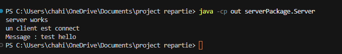
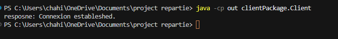
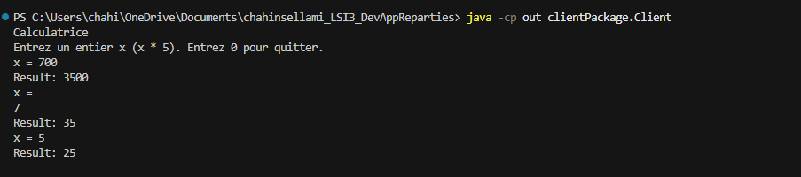
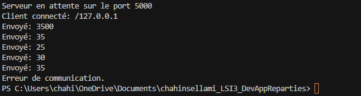
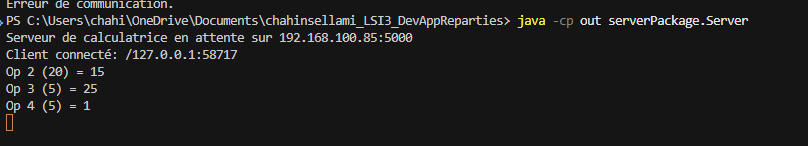

# TP1 - Calculatrice TCP Client/Serveur

Projet de développement d'applications réparties (DAR) - Activités 1-1 à 1-3

---

## 📖 À propos

Ce projet est une calculatrice client-serveur qui communique via TCP sur un port configurable. L'architecture permet plusieurs clients de se connecter en parallèle, chacun recevant des résultats en temps réel.

## 📁 Structure
```
.
├── src/
│   ├── clientPackage/
│   │   └── Client.java
│   └── serverPackage/
│       └── Server.java
├── screenshots/
│   └── *.png
├── README.md
└── .gitignore
```


## 📊 Résultats des activités

### Activité 1-1
Architecture de base avec boucle continue de requêtes.




### Activité 1-2
Support des entiers négatifs et gestion propre de la fermeture de session.




### Activité 1-3
Menu-driven avec 4 opérations (add, sub, mul, div) et connexion cross-machine.




---

## 🚀 Compilation

```powershell
javac -d out src\serverPackage\Server.java src\clientPackage\Client.java
```

---

## 📡 Lancement

### Serveur
```powershell
java -cp out serverPackage.Server [port]
```
Port par défaut : 5000

### Client
```powershell
java -cp out clientPackage.Client [host] [port]
```
Host par défaut : localhost  
Port par défaut : 5000

### Cross-machine
```powershell
java -cp out clientPackage.Client 192.168.1.100 5000
```

---

## 💻 IDE & Execution

**Pure Java (JDK 8+), zero external dependencies.**

I developed using VS Code (same workflow as IntelliJ):

1. Compile:
   ```powershell
   javac -d out src\serverPackage\Server.java src\clientPackage\Client.java
   ```

2. Run server (terminal 1):
   ```powershell
   java -cp out serverPackage.Server 5000
   ```

3. Run client (terminal 2):
   ```powershell
   java -cp out clientPackage.Client localhost 5000
   ```

Try-with-resources (`try (Socket socket = ...)`) ensures clean, automatic file closure. The code runs identically in any IDE.

---

